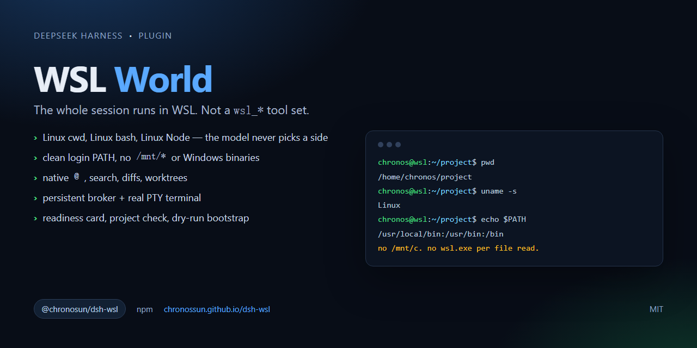

# WSL World for DSH

[](https://www.npmjs.com/package/@chronosun/dsh-wsl)
[](https://github.com/ChronosSun/dsh-wsl/actions/workflows/ci.yml)
[](https://github.com/ChronosSun/dsh-wsl/blob/master/LICENSE)



**`dsh-wsl` is a complete WSL execution world for DeepSeek Harness, not a
`wsl_*` tool set.** One DSH session runs its bash, filesystem tools, terminal,
search and `@` references inside a local WSL distribution — Linux paths, Linux
tools, no Windows/9P indirection.

- npm: `@chronosun/dsh-wsl`
- plugin-market index: `https://chronossun.github.io/dsh-wsl/index.json`
- package source: [`pkg/`](pkg/)
- market index source: [`market/`](market/)

## Choose this if

- your project lives in WSL and you want ext4 instead of `/mnt/c`;
- you want one session to stay in Linux, not one `wsl.exe` per command;
- you want native Linux `@`, search, diffs and worktrees;
- you are fine with a one-time WSL workspace/preset setup.

If you only need occasional Linux commands from a Windows session, a
`wsl_*` tool plugin is the lower-friction choice. See
[the package README](pkg/README.md).

## Install

```powershell
dsh plugin --profile desktop add @chronosun/dsh-wsl
```

Then quit DSH from the tray and reopen it. The WSL panel appears in the
sidebar; create a workspace from a directory inside a distribution.

Requirements: Windows, WSL 2, and a Linux Node.js in the distribution (the
doctor can install it), plus an optional non-root user. The plugin does not
install anything into the distribution by default.

## Market

DSH currently has no official central index. Host `market/` on GitHub Pages
(see [`market/README.md`](market/README.md)), then users enable **Custom plugin
indexes** and add:

```text
https://chronossun.github.io/dsh-wsl/index.json
```

## Development

```powershell
cd pkg
npm pack
```

Submission copy for third-party indexes: [`docs/SUBMISSION.md`](docs/SUBMISSION.md).

The package tests are under [`pkg/test/`](pkg/test/). GitHub Actions runs the
pure unit tests and the release contract; WSL integration tests are opt-in:

```bash
cd pkg
npm test
DSH_WSL_INTEGRATION=1 npm test
npm run check
```

## License

MIT
